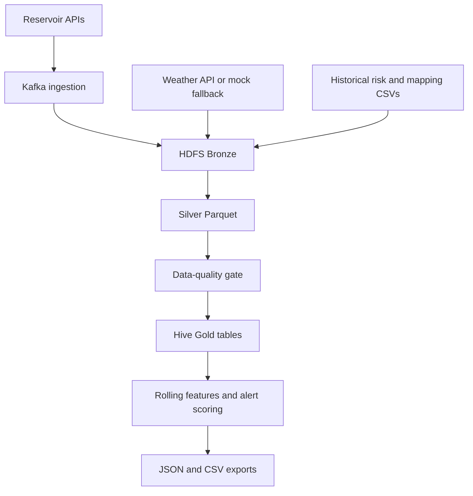

# Thailand Flood Risk Data Pipeline

**Academic project · ITDS344 Data Engineering and Infrastructures · Mahidol University**

A data engineering pipeline that brings reservoir observations, weather inputs and historical flood-risk data into a layered warehouse for analysis. It demonstrates ingestion, orchestration, data quality, dimensional modelling and reproducible analytical exports.

[Operations guide](docs/OPERATIONS.md) · [Warehouse documentation](DATA_WAREHOUSE.md) · [Power BI setup](POWERBI_SETUP.md) · [Project explanation](PROJECT_EXPLANATION.md)

## What the project implements

- Reservoir ingestion through Kafka, with producer state and consumer watermark tracking.
- HDFS Bronze storage for raw inputs and Silver Parquet datasets for transformed data.
- A data-quality gate before downstream warehouse processing.
- Hive Gold dimension/fact tables and a rule-based province-level alert score.
- Rolling reservoir features and JSON/CSV exports for downstream dashboards.
- An Airflow workflow scheduled every six hours.

This is an academic implementation. Alert scores illustrate a composite scoring method; they are not validated operational flood forecasts.

## Architecture



The diagram summarizes the executable Airflow dependency order. Detailed task and storage information is in the [operations guide](docs/OPERATIONS.md).

## Technical stack

| Responsibility | Implementation |
| --- | --- |
| Processing and exports | Python, pandas, PyArrow |
| Event ingestion | Apache Kafka |
| Layered storage | HDFS, JSON, Parquet and ORC |
| Analytical warehouse | Apache Hive |
| Orchestration | Apache Airflow |
| Local environment | Docker Compose |

The repository provides pipeline and export code. A standalone dashboard frontend is not included.

## Explore the implementation

| Location | Purpose |
| --- | --- |
| `dags/flood_pipeline_dag.py` | Task dependencies, schedule and retries |
| `ingestion/` | API ingestion, Kafka integration and HDFS helpers |
| `transformation/` | Bronze-to-Silver processing and rolling features |
| `quality/data_quality.py` | Null, duplicate and numeric-range checks |
| `warehouse/` | Hive schema, Gold loading and alert scoring |
| `scripts/` | JSON and CSV export utilities |
| `data/` | Static source files and generated-output locations |

## Run locally

Allocate approximately **12 GB of free RAM and 20 GB of disk space** for the documented Docker environment. First startup requires downloading several service images.

```bash
git clone https://github.com/iimmyyy/flood-monitoring.git
cd flood-monitoring
docker compose up -d
docker compose ps
```

Then follow the [operations guide](docs/OPERATIONS.md) to initialize HDFS and trigger `flood_risk_monitoring_pipeline` at **http://localhost:8080**. The supplied local demonstration account is `admin / admin`.

The existing Compose environment is a local academic setup. Its development credentials and exposed service ports are not a production deployment configuration.

### Weather configuration

The weather script reads `TMD_API_KEY` from its process environment. A project-root `.env` file is not automatically forwarded to every container by the current Compose file. If configuring a weather token, pass it explicitly to the process/container that runs the script. Never commit a real token.

Weather generation can fall back to simulated values when the API request fails. Interpret downstream scores with that data provenance in mind.

## Data quality and scoring

The current quality module implements three check families:

- Required fields: `reservoir_id`, `record_date` and `percent_storage`.
- Duplicate records using the available reservoir/date/source key columns.
- Numeric ranges for storage, volume, inflow and outflow.

These produce multiple report entries when the corresponding columns are present. The current module does not implement the older README's claimed freshness and minimum-row-count checks.

The alert score combines:

| Component | Maximum contribution |
| --- | ---: |
| Reservoir state | 40 |
| Weather | 35 |
| Historical risk | 25 |

The implementation groups the total score into normal, watch, alert and crisis levels. Thresholds and reservoir-to-province mappings are project assumptions, not evidence of forecasting accuracy.

## Outputs and verification

After a successful run, inspect:

- The Airflow task logs and status for the triggered run.
- Hive Gold tables and the selected date partition.
- `data/dq_reports/` for quality reports.
- `data/exports/` for JSON snapshots.

Generate CSVs from existing JSON exports from the repository root:

```bash
python scripts/export_gold_to_csv.py
```

See [POWERBI_SETUP.md](POWERBI_SETUP.md) for the downstream visualization workflow. Output counts depend on upstream data; example counts should not be treated as guarantees.

## Scope and limitations

- Real API inputs and mock weather fallback can coexist.
- Scoring is heuristic and has not been established as an operational warning model.
- Some task commands use the current container date; historical reruns need consistent date handling.
- External APIs, container versions and the local environment affect reproducibility.
- A screenshot or sample report should be tied to a specific actual run; no performance or accuracy improvement is claimed here.

Maintained as part of [Immy's portfolio](https://www.immy.website/).
