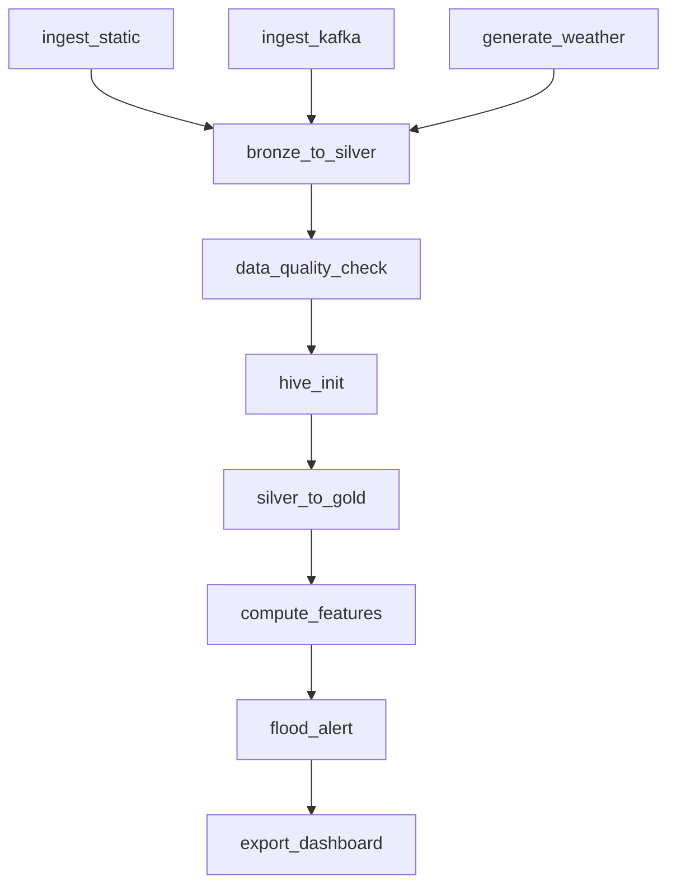

# Local Operations Guide

This guide describes the checked-in academic Docker environment. Start with the [project overview](../README.md) for architecture and limitations.

## 1. Prepare the repository

```bash
git clone https://github.com/iimmyyy/flood-monitoring.git
cd flood-monitoring
```

Requirements documented for this environment:
- Docker Desktop / Docker Compose.
- Approximately 12 GB of free RAM and 20 GB of free disk space.
- Internet access for image downloads and the upstream reservoir/weather services.

The static files are `data/flood_risk_area.csv` and `data/reservoir_downstream_map.csv`. Keep the input formats compatible with their ingestion code.

### Weather environment

The script `ingestion/mock_weather_generator.py` reads `TMD_API_KEY` from the environment of the Python process. The older setup text referred to `TMD_API_TOKEN`; that is not the name read by the current script.

A root `.env` file is not automatically passed into the Airflow containers by this Compose file. Configure the token in the appropriate container/process environment if using an authorized weather API token. Do not commit real tokens. Weather requests can fall back to generated values, so a completed pipeline run alone does not prove every weather record is real.

## 2. Start and inspect services

```bash
docker compose up -d
docker compose ps
```

First startup downloads multiple service images. Inspect health and logs rather than relying on a fixed wait time:

```bash
docker compose logs --tail 50 namenode
docker compose logs --tail 50 airflow-webserver
```

The `airflow-init` container performs database/user initialization and can exit after completing that task. Other services include Hadoop, Kafka/Zookeeper, Hive and the Airflow scheduler/webserver. This setup uses LocalExecutor; there is no separate `airflow-worker` container.

## 3. Initialize HDFS locations

```bash
docker exec namenode hdfs dfs -mkdir -p /bronze/reservoir /bronze/dam /bronze/weather /bronze/flood_risk /bronze/static
docker exec namenode hdfs dfs -mkdir -p /silver/reservoir /silver/flood_risk /silver/weather /silver/reservoir_features
docker exec namenode hdfs dfs -mkdir -p /gold/Fact_Flood_Alert
```

## 4. Trigger the Airflow workflow

Open **http://localhost:8080**. The local demonstration account configured by Compose is `admin / admin`.

Enable and trigger `flood_risk_monitoring_pipeline`. Inspect task logs in the Airflow UI.

### Executable task order



| Task | Main responsibility |
| --- | --- |
| `ingest_static` | Load static flood-risk and mapping data |
| `ingest_kafka` | Produce reservoir inputs and consume into Bronze |
| `generate_weather` | Request weather inputs with mock fallback |
| `bronze_to_silver` | Clean and type-cast data into Parquet |
| `data_quality_check` | Gate downstream processing on critical checks |
| `hive_init` | Create external/Gold table definitions |
| `silver_to_gold` | Load warehouse dimensions and facts |
| `compute_features` | Calculate rolling reservoir features |
| `flood_alert` | Produce composite province-level scores |
| `export_dashboard` | Export JSON snapshots |

Schedule: `0 */6 * * *`. Retry policy: two retries with a five-minute delay. Several commands use the container's current date; inspect date handling before historical reruns.

## 5. Inspect generated data

Open HiveServer2:

```bash
docker exec -it hive-server beeline -u "jdbc:hive2://localhost:10000/flood_monitoring"
```

For example, using the partition date generated by your actual run:

```sql
SELECT prov_th, alert_level, alert_score, reservoir_score
FROM Fact_Flood_Alert
ORDER BY alert_score DESC
LIMIT 10;

SELECT dt, COUNT(*)
FROM Fact_Water_Monitoring
GROUP BY dt
ORDER BY dt DESC;
```

Inspect `data/dq_reports/` and `data/exports/` for quality reports, alerts, reservoir summaries and metadata. Counts depend on the upstream sources and selected data; use your generated results rather than fixed example counts.

### JSON-to-CSV export

From the repository root, after JSON snapshots exist:

```bash
python scripts/export_gold_to_csv.py
```

This step needs the script's dependencies in the Python environment. The CSV files are written beneath `data/exports/csv/`.

See [Power BI setup](../POWERBI_SETUP.md) for downstream loading and refresh instructions.

## 6. Run individual stages

Use the Airflow scheduler container, which has the project directories mounted:

```bash
docker exec -it airflow-scheduler bash
```

The following example date is illustrative; replace it with the partition you intend to process:

```bash
python /opt/airflow/ingestion/mock_weather_generator.py 2026-04-23
python /opt/airflow/ingestion/kafka_producer.py
python /opt/airflow/ingestion/kafka_consumer.py
python /opt/airflow/transformation/bronze_to_silver.py 2026-04-23
python /opt/airflow/quality/data_quality.py 2026-04-23
python /opt/airflow/warehouse/silver_to_gold.py 2026-04-23
python /opt/airflow/transformation/compute_reservoir_features.py 2026-04-23
python /opt/airflow/warehouse/flood_alert_scoring.py 2026-04-23
python /opt/airflow/scripts/export_gold_to_json.py 2026-04-23
```

Initialize Hive tables before manually running Gold/scoring stages. The Airflow workflow performs that initialization through `hive_init`; inspecting the configured task is the clearest reference.

## 7. Quality checks implemented in this version

`quality/data_quality.py` runs three families of checks and writes multiple result entries:

| Check | Fields / condition | Severity |
| --- | --- | --- |
| Required fields | `reservoir_id`, `record_date`, `percent_storage` | Critical |
| Duplicates | Available columns among `reservoir_id`, `record_date`, `source` | Critical |
| Storage range | `percent_storage` between 0 and 100 | Critical |
| Volume range | `volume_mcm` between 0 and 99,999 | Critical |
| Flow range | `inflow_mcm`, `outflow_mcm` between -10 and 9,999 | Warning |

Numeric checks are skipped for absent columns. Empty/unavailable Silver data is a critical failure. A non-zero exit stops downstream tasks.

Freshness and minimum-row-count checks described in older documentation are not implemented by this current module.

## 8. Incremental processing and reruns

| Mechanism | Implementation |
| --- | --- |
| Producer state | Tracks previous production/backfill state |
| Consumer watermark | Filters consumed records relative to a stored watermark |
| Layered partitions | Separates data by date in HDFS |
| Parquet replacement | Rewrites transformed output paths |
| Hive loading | Uses partition overwrite for Gold loading |

These are implementation mechanisms, not a claim that every failure/retry scenario has been exhaustively tested. Check task logs, state files and the intended partition before replaying data.

## 9. Service interfaces

| Service | Local URL |
| --- | --- |
| Airflow | http://localhost:8080 |
| HDFS NameNode | http://localhost:9870 |
| YARN ResourceManager | http://localhost:8088 |
| Hive Web UI | http://localhost:10002 |

HiveServer2 uses local port `10000` for JDBC/ODBC. Keep this demonstration configuration on an appropriate development network.

## 10. Stop services

```bash
docker compose stop
```

Or remove containers while keeping named volumes:

```bash
docker compose down
```

Preserve volumes if you need the stored data and Airflow state. A full volume reset is a separate destructive operation, not the default fix for a failing service.

## Troubleshooting

| Symptom | First checks |
| --- | --- |
| A service is restarting | Read its logs and inspect its dependencies/health status |
| `airflow-init` has exited | Check whether initialization completed successfully |
| Kafka publishes no records | Inspect upstream API availability and producer logs |
| Hive queries are slow initially | Inspect the Hive/MapReduce startup and task logs |
| Host port is occupied | Adjust the relevant Compose host-port mapping |
| `airflow-worker` is missing | Use `airflow-scheduler` in this LocalExecutor setup |
| Gold alerts are absent | Check upstream task status, selected dates and ORC output/export paths |
| Quality gate fails | Inspect the generated report and underlying Silver data before rerunning |

Further references: [warehouse model](../DATA_WAREHOUSE.md), [project explanation](../PROJECT_EXPLANATION.md), and the checked-in source for current behavior.
